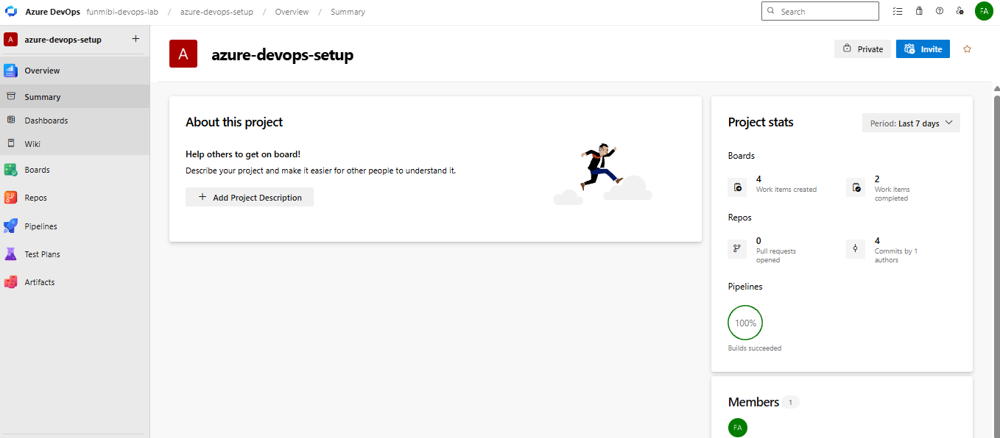
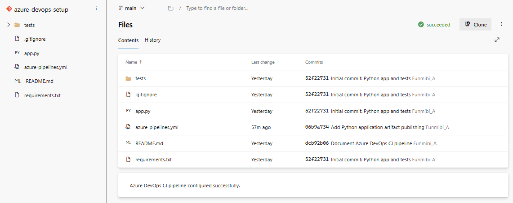
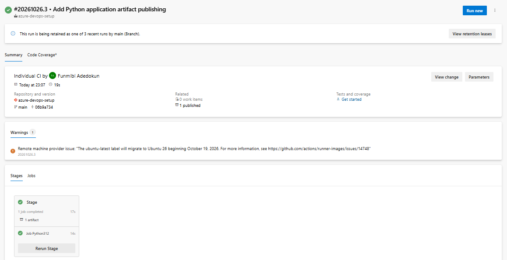
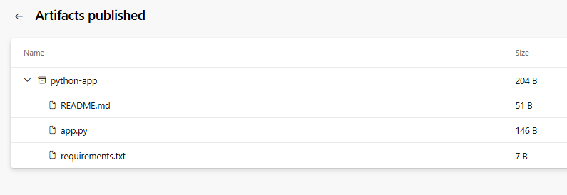
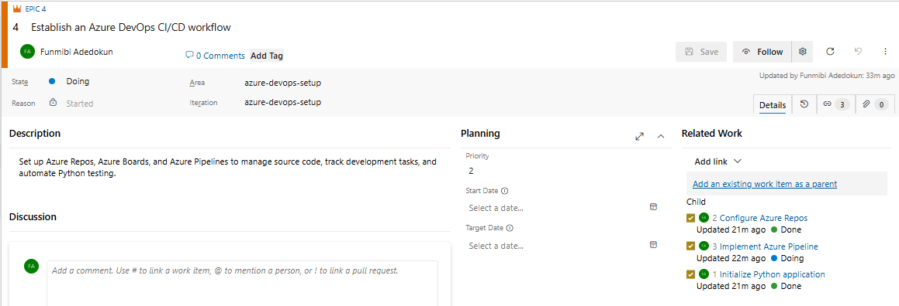
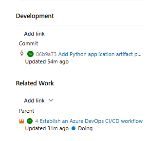

# Azure DevOps Setup Complete

A hands-on project demonstrating how Microsoft Azure DevOps integrates source code management, continuous integration, automated testing, artifact publishing, and Agile project management.

## 1. Project Overview

This project demonstrates the fundamentals of Azure DevOps by integrating Azure Repos, Azure Pipelines, and Azure Boards into a single development workflow.

A Python application is maintained in a Git repository hosted on Azure Repos. Azure Pipelines automates application validation, runs automated tests, and publishes the application files as a build artifact. Azure Boards provides a structured way to manage tasks and associate implementation work with source code changes.

The project covers the foundational stages of the Software Development Lifecycle (SDLC), from planning and version control to continuous integration and artifact publishing.

## 2. Technology Stack

| Component | Technology or Configuration |
|---|---|
| DevOps platform | Microsoft Azure DevOps |
| Organization | `funmibi-devops-lab` |
| Project | `azure-devops-setup` |
| Source control | Git |
| Repository | `azure-devops-setup` |
| Main branch | `main` |
| Application language | Python |
| Automated testing | pytest |
| Pipeline definition | `azure-pipelines.yml` |
| Pipeline agent | `ubuntu-latest` |
| Pipeline job | `Python312` |
| Artifact publishing | `PublishPipelineArtifact@1` |
| Work tracking | Azure Boards |

## 3. Azure DevOps Organization and Project

The project was created within the `funmibi-devops-lab` Azure DevOps organization.

The `azure-devops-setup` project serves as the central workspace for source code, CI pipeline configuration, and Agile work tracking.

**Project URL:**  
https://dev.azure.com/funmibi-devops-lab/azure-devops-setup

### Project overview

The project overview provides access to the integrated Azure DevOps services used throughout the implementation.

*Figure 1: Azure DevOps project overview.*

## 4. Azure Repos and Source Code Management

Azure Repos was used to host the Git repository and maintain version history for the Python application and its supporting files.

The local development environment was connected to the remote repository. Changes were committed and pushed to the `main` branch.

**Repository URL:**  
https://dev.azure.com/funmibi-devops-lab/azure-devops-setup/_git/azure-devops-setup

### Key repository files

| File | Purpose |
|---|---|
| `app.py` | Python application source code |
| `requirements.txt` | Python dependency definitions |
| `azure-pipelines.yml` | Azure Pipeline configuration |
| `README.md` | Project documentation |
| `tests/` | Automated application tests |
| `screenshots/` | Project implementation evidence |
| `.gitignore` | Specifies files and directories excluded from Git |

The repository structure keeps application code, tests, pipeline configuration, and documentation organized in one version-controlled location.

*Figure 2: Azure Repos repository file structure.*

## 5. Azure Pipelines and Continuous Integration

An Azure Pipeline was configured using `azure-pipelines.yml` to automate the application's validation and artifact preparation.

The pipeline uses an Ubuntu-hosted agent and a Python 3.12 job named `Python312`.

### Pipeline workflow

The pipeline performs the following operations:

1. **Source checkout:** Retrieves the repository contents for the selected commit.
2. **Application validation:** Prepares the environment and executes the configured pipeline steps.
3. **Automated testing:** Runs `python -m pytest -v` to execute the automated tests.
4. **Artifact preparation:** Creates a staging directory and copies `app.py`, `requirements.txt`, and `README.md` into it.
5. **Artifact publishing:** Uses `PublishPipelineArtifact@1` to publish the staged files as an artifact named `python-app`.

### Pipeline configuration

The pipeline is defined in the repository's `azure-pipelines.yml` file. It is configured to run against changes on the `main` branch.

### Successful pipeline execution

Multiple successful pipeline runs were recorded during implementation.

The latest documented run was:

- **Run:** `#20261026.3`
- **Commit:** `06b9a734`
- **Commit message:** Add Python application artifact publishing
- **Branch:** `main`
- **Job:** `Python312`
- **Result:** Succeeded
- **Published artifacts:** 1

The successful run confirms that the pipeline completed its configured steps and published the application artifact.

[View Azure Pipeline runs](https://dev.azure.com/funmibi-devops-lab/azure-devops-setup/_build)

*Figure 3: Successful Azure Pipeline execution.*

### Published application artifact

The application files are published as a pipeline artifact named `python-app`. This makes the prepared application files available for inspection or download from the completed pipeline run.

Artifact publishing demonstrates a foundational step toward a more comprehensive CI/CD workflow.

*Figure 4: Published Python application artifact.*

**Note:** The project implements continuous integration and artifact publishing. A separate application deployment stage has not been established as part of this implementation.

## 6. Azure Boards and Work Tracking

Azure Boards was used to organize and track the project activities through an Epic and three associated tasks.

### Work-item hierarchy

| Work item | ID | Description |
|---|---:|---|
| Epic | 4 | Establish an Azure DevOps CI/CD workflow |
| Task | 1 | Initialize Python application |
| Task | 2 | Configure Azure Repos |
| Task | 3 | Implement Azure Pipeline |

All three tasks were linked to the Epic through their Parent relationships.

This structure demonstrates how a broader project objective can be broken down into smaller, trackable implementation activities.

*Figure 5: Azure Boards showing the Epic and its associated tasks.*

## 7. Workflow Integration and Traceability

The project integrates Azure Boards, Azure Repos, and Azure Pipelines to improve visibility across planning, implementation, and validation.

### Traceability implementation

Task ID 3, **Implement Azure Pipeline**, was linked to the source code commit:

- **Commit:** `06b9a734`
- **Commit message:** Add Python application artifact publishing
- **Branch:** `main`

The commit appears in the work item's Development section, allowing the associated code change to be opened directly from Azure Boards.

Task ID 3 is also linked to Parent ID 4, **Establish an Azure DevOps CI/CD workflow**.

This establishes the relationship between the project objective, implementation task, and source code change.

*Figure 6: Azure Boards work item showing its linked commit and parent Epic.*

The pipeline run independently confirms that the same commit was built successfully and that one artifact was published. This provides supporting evidence of successful continuous integration.

The run summary previously displayed zero related work items, so automatic work-item association with the pipeline run itself has not been confirmed. The commit-to-work-item link is established.

## 09. Challenges and Lessons Learned

The implementation provided practical experience with the configuration and integration of Azure DevOps services.

Key lessons included:

- Connecting a local Git repository to Azure Repos.
- Managing commits and pushing source code changes to a remote branch.
- Creating and validating an Azure Pipeline using YAML.
- Interpreting pipeline run status, job results, and warnings.
- Running automated tests through a CI pipeline.
- Preparing and publishing application files as a pipeline artifact.
- Creating an Epic and linking tasks using Parent relationships in Azure Boards.
- Associating source code commits with Azure Boards work items.
- Understanding the distinction between continuous integration, artifact publishing, and application deployment.
- Documenting project configuration and capturing evidence for submission.

